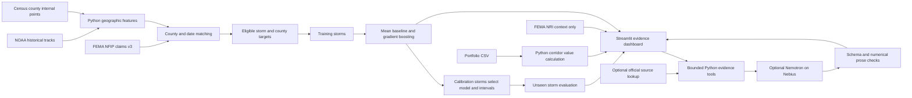

# StormSight architecture

The original NOAA file stays unchanged. FEMA claim downloads use only selected columns and event date windows. Raw claim caches stay local. The shared app uses county aggregates and a locally trained model artifact.

All model targets are NFIP payment proxies selected by the stated matching rule. They are not all hurricane losses. Current NRI risk scores do not enter the model. Portfolio insured values are not multiplied by arbitrary damage ratios.

The agent can only call named tools bound to the selected storm. It cannot run shell commands, select arbitrary URLs, or access files. API keys stay on the server. Numerical evidence is generated and rendered by Python. Qualitative AI text can still be wrong and requires review.
